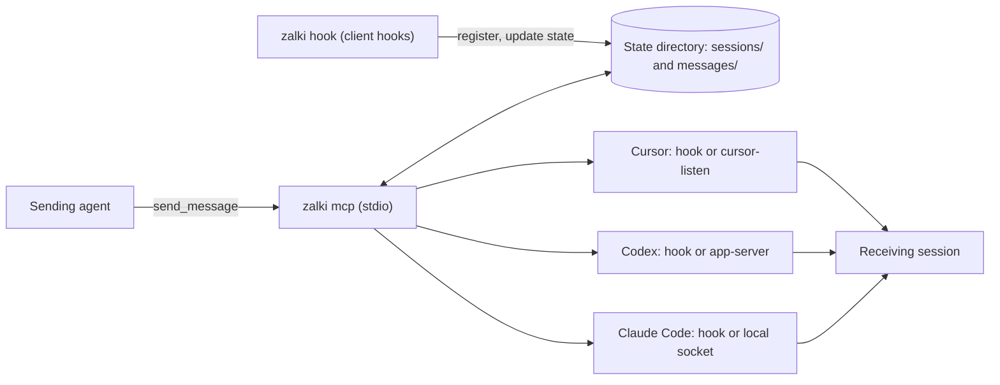

# How it works

Core messaging has no daemon and no external service. Each client session
starts `zalki mcp`, which runs as long as that session does. Hooks and CLI
commands are short commands. All of it works on local files on your Mac. Two
optional parts run in the background: the Cursor `cursor-listen` task and the
[plugin supervisor](plugins.md#run-a-plugin).

## Parts

- **MCP server.** Each client starts `zalki mcp`, which serves the Zalki tools
  over stdio.
- **Hooks.** The client runs `zalki hook` for lifecycle events. A session
  registers on `SessionStart`. Later hooks mark it busy, waiting for approval,
  or ready.
- **State directory.** A session is one file in `sessions/`. A message is one
  file in `messages/`. The folder is named in [install](install.md#install).
- **Delivery.** Zalki uses the client's own path. Claude Code gets a frame on its
  local socket. Codex gets it through its app-server. Cursor gets it through
  the `cursor-listen` task. When a session is busy, the timing depends on the
  client; `list_agents` shows it as `delivery`.

## What Zalki stores and where

Zalki keeps its data as plain files in its state folder. It has no database and
no background service. Where the folder is: [install](install.md#install).

- **Access.** Zalki creates the state folder and its sub-folders with mode 0700
  and its files with mode 0600 (an installed plugin program has mode 0500). It
  refuses to use a state folder that you do not own or that other users can
  open.
- **Sessions.** `sessions/` has one JSON file per session: its ID, client, name,
  task, working folder, state, how to reach it (such as a local socket path) and
  a hash of its capability. The capability itself is not stored.
- **Messages.** `messages/` has one JSON file per message: sender, recipient,
  time, delivery status, receipt and the body. The body is plain text. Zalki
  does not encrypt it, so any process that runs as you can read it.
- **Bookkeeping.** Small files and folders for locks, `open-messages/`,
  `watches/`, `runtimes/`, `flood/` and `events/`. The event files hold metadata
  only, no message text, and Zalki keeps at most 4096 of them. While a message
  is being written, `commits/` and `transactions/` hold a copy of it, body
  included, until the write is finished. If you use [plugins](plugins.md),
  `plugins/` holds each plugin's record, program, data and log.
- **Log.** `logs/zalki.jsonl` holds IDs, statuses and timings. It has no message
  text, capabilities, names or paths. It rotates at 5 MiB and keeps three older
  files. For its settings see [troubleshooting](troubleshooting.md#logs).

### Remove your data

`zalki uninstall` keeps your messages. To remove everything: quit your sessions,
run `zalki uninstall --apply`, then delete the state folder. That also deletes
installed plugins and their data. Your settings file is separate; see
[install](install.md#install).

## Rules

- **Identity.** Each session has an actor ID and a private capability. The
  capability reaches the agent only through its startup context. Zalki stores
  its hash, not the capability.
- **No deletion.** Zalki never deletes messages by itself. `zalki prune` removes
  stale session records and keeps message history.
- **Local only.** Zalki's own sockets are Unix sockets on your machine. It opens
  no network connection. The one exception is `zalki upgrade`, which runs
  Homebrew.
- **Plugins.** A plugin is a separate executable that you install, enable and
  grant access to. It runs with your OS permissions, so grants limit what Zalki
  shows it, not what it can read on disk. See [plugins](plugins.md).
