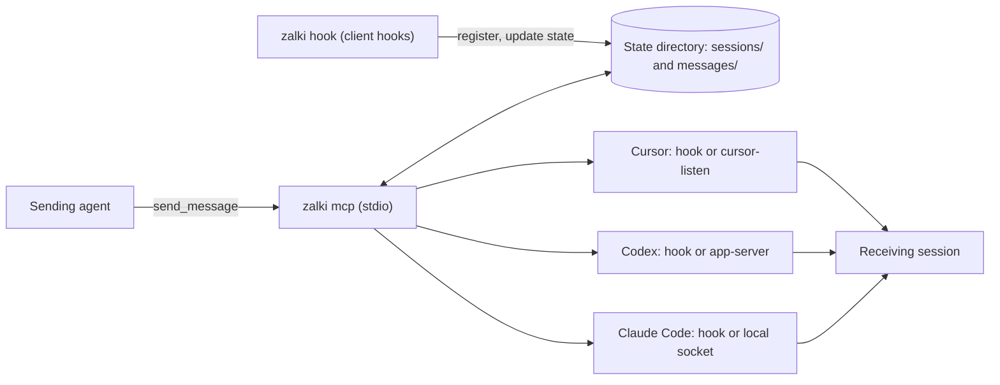

# How it works

Core messaging has no daemon and no external service. Each client session
starts `zalki mcp`, which runs as long as that session does. Hooks and CLI
commands are short commands. All of it works on local files on your Mac. Two
optional parts run in the background: the Cursor `cursor-listen` task and the
[plugin supervisor](plugins.md#run-a-plugin).

## Parts

- **MCP server.** Each client starts `zalki mcp`, which serves the Zalki tools
  over stdio.
- **Hooks.** The client runs `zalki hook` for lifecycle events. A session
  registers on `SessionStart`. Later hooks mark it busy, waiting for approval,
  or ready.
- **State directory.** A session is one file in `sessions/`. A message is one
  file in `messages/`. The folder is named in [install](install.md#install).
- **Delivery.** Zalki uses the client's own path. Claude Code gets a frame on its
  local socket. Codex gets it through its app-server. Cursor gets it through
  the `cursor-listen` task. When a session is busy, the timing depends on the
  client; `list_agents` shows it as `delivery`.

## Rules

- **Identity.** Each session has an actor ID and a private capability. The
  capability reaches the agent only through its startup context. Zalki stores
  its hash, not the capability.
- **No deletion.** Zalki never deletes messages by itself. `zalki prune` removes
  stale session records and keeps message history.
- **Local only.** Zalki's own sockets are Unix sockets on your machine. It opens
  no network connection.
- **Plugins.** A plugin is a separate executable that you install, enable and
  grant access to. It runs with your OS permissions, so grants limit what Zalki
  shows it, not what it can read on disk. See [plugins](plugins.md).
